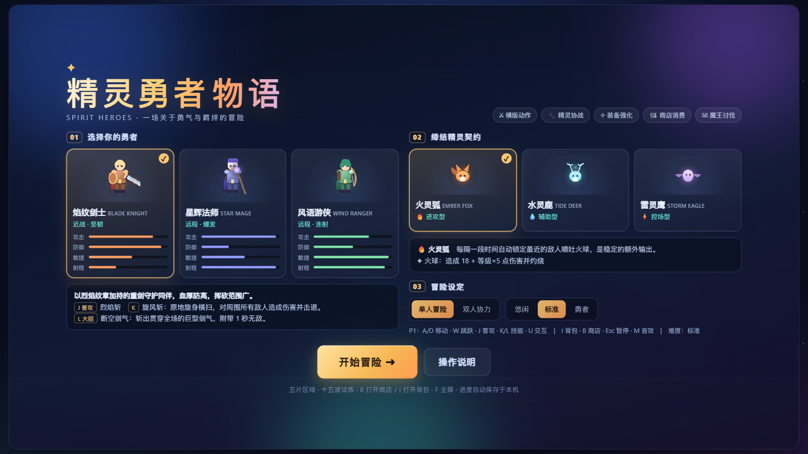
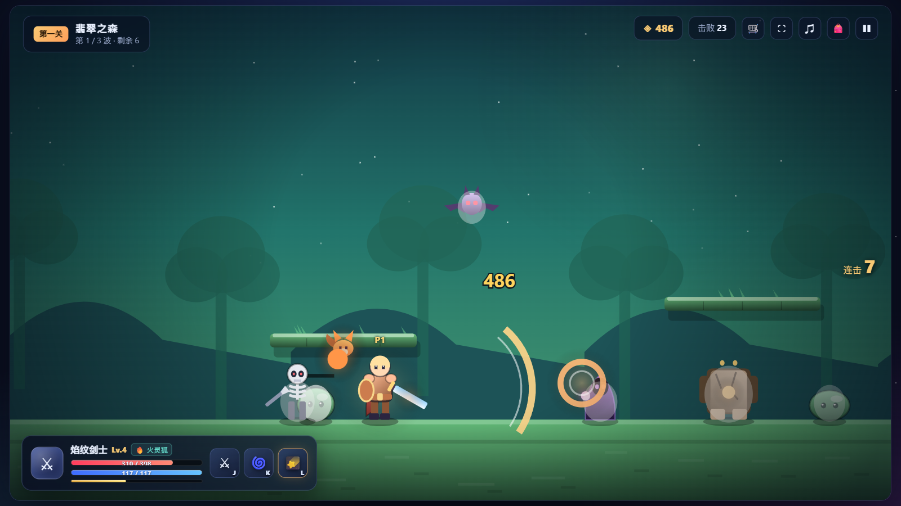
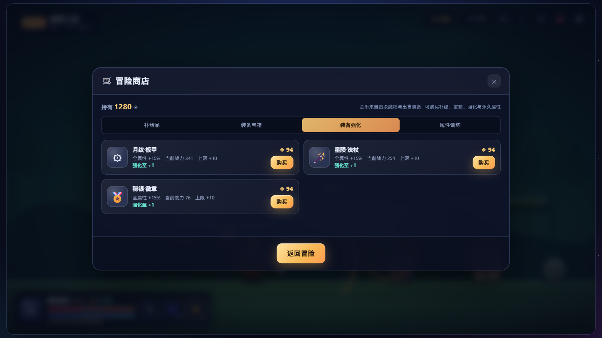
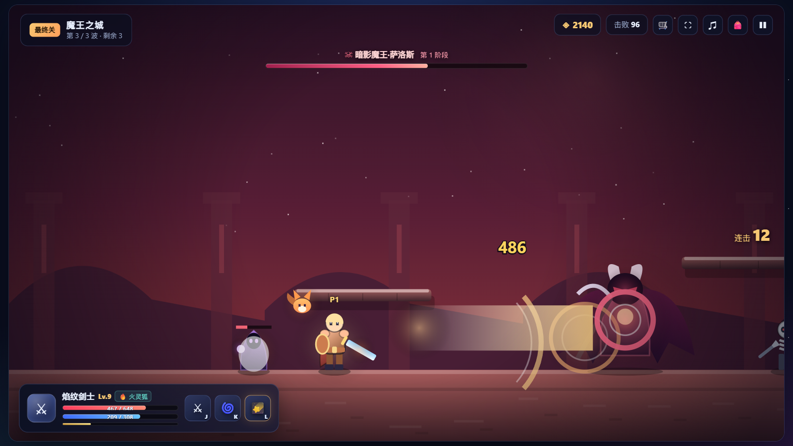

# 精灵勇者物语 · Spirit Heroes

> 一款参考经典 Flash 小游戏《勇者之路精灵物语》制作的网页横版动作 RPG。
> **纯原生 HTML / CSS / JavaScript，零依赖、零构建、零外部素材 —— 整个游戏就是 `index.html` 一个文件。**



---

## 目录

- [游戏简介](#游戏简介)
- [游戏截图](#游戏截图)
- [快速开始](#快速开始)
- [操作说明](#操作说明)
- [职业与精灵](#职业与精灵)
- [关卡与魔物](#关卡与魔物)
- [成长与商店](#成长与商店)
- [技术实现](#技术实现)
- [文件结构](#文件结构)

---

## 游戏简介

选择一位勇者，与一只精灵缔结契约，穿过五片风格迥异的区域，击败最终魔王。

- **3 位职业**：近战坚韧的剑士、范围爆发的法师、高速连射的游侠，各有普攻 + 2 个技能（含大招）
- **3 只精灵**：自动协同作战，分别负责输出、治疗与控场
- **5 关 15 波**：森林、洞窟、雪原、熔岩、魔王城，每关 3 波，最终三阶段 Boss
- **装备驱动成长**：随机品质掉落、战力对比、装备强化、永久属性训练
- **双人同屏协力**：两套键位、倒地可复活、共享金币与独立背包
- **完整体验**：升级、连击、掉落、存档、难度选择、全屏、合成音效与 BGM

---

## 游戏截图

| 开始界面 · 职业与精灵选择 | 战斗画面 · 技能特效与魔物 |
| :---: | :---: |
|  |  |
| 三张职业卡与三张精灵卡带程序化绘制的立绘，可切换单人 / 双人、悠闲 / 标准 / 勇者难度 | 剑气、范围斩击、伤害浮字、连击计数与实时血条 / 法力条 |

| 冒险商店 · 装备强化 | 最终关 · 魔王讨伐 |
| :---: | :---: |
|  |  |
| 出售装备获得的金币可购买补给、开装备宝箱、强化装备到 +10、训练永久属性 | 三阶段 Boss，弹幕、召唤仆从、冲刺与专属血条 |

---

## 快速开始

**方式一：直接打开（推荐）**

双击 `index.html`，用任意现代浏览器（Chrome / Edge / Firefox / Safari）打开即可游玩，不需要安装任何东西。

**方式二：本地静态服务器（可选）**

```bash
# Python
python -m http.server 8000

# 或 Node.js
npx serve .
```

然后访问 `http://localhost:8000`。

**方式三：GitHub Pages 在线游玩**

在本仓库 `Settings → Pages` 中，Source 选择 `Deploy from a branch`，分支选 `main`、目录选 `/ (root)`，保存后即可通过
`https://<你的用户名>.github.io/jinglingwuyu/` 访问。

> 进度保存在浏览器 `localStorage`，通关后存档会清空；按 `F` 或点右上角 `⛶` 可全屏游玩。

---

## 操作说明

### 玩家 1

| 操作 | 按键 |
| --- | --- |
| 移动 / 跳跃 | `A` `D` / `W` |
| 普通攻击 | `J`（支持按住连发与快速点按） |
| 技能一 / 技能二（大招） | `K` / `L` |
| 拾取 / 传送门交互 / 复活同伴 | `U`（复活需按住） |

### 玩家 2（双人协力）

| 操作 | 按键 |
| --- | --- |
| 移动 / 跳跃 | `←` `→` / `↑` |
| 普通攻击 | 主键盘 `1` 或小键盘 `1`（备用 `4`） |
| 技能一 / 技能二 | 主键盘 `2` `3` 或小键盘 `2` `3`（备用 `5` `6`） |
| 拾取 / 传送门交互 / 复活同伴 | 主键盘 `0` 或小键盘 `0` |

### 通用

| 操作 | 按键 |
| --- | --- |
| 背包 / 装备 | `I` |
| 冒险商店 | `B` |
| 暂停 | `Esc` 或 `P` |
| 音效开关 / 操作说明 / 全屏 | `M` / `H` / `F` |

触屏设备会自动显示虚拟按键。

---

## 职业与精灵

| 职业 | 定位 | 普攻 | 技能一 | 技能二（大招） |
| --- | --- | --- | --- | --- |
| 焰纹剑士 | 近战 · 高血高防 | 烈焰斩（范围挥砍） | 旋风斩：周身 AOE + 击退 | 断空剑气：贯穿全场剑气 + 短暂无敌 |
| 星辉法师 | 远程 · 范围爆发 | 星尘弹 | 烈焰风暴：前方火柱 + 灼烧 | 冰霜新星：全屏伤害 + 冻结 2 秒 |
| 风语游侠 | 远程 · 高攻速高暴击 | 疾风箭 | 连珠箭：五支扇形追踪箭 | 苍穹箭雨：前方区域持续覆盖 |

| 精灵 | 定位 | 自动技能 |
| --- | --- | --- |
| 火灵狐 🔥 | 进攻 | 锁定最近敌人发射火球，附加灼烧 |
| 水灵鹿 💧 | 辅助 | 生命偏低时降下治愈之雨，同时回复法力 |
| 雷灵鹰 ⚡ | 控场 | 连锁闪电，最多命中 3 名敌人并使其麻痹 |

多人模式下，玩家 2 自动使用另一职业与另一只精灵。

---

## 关卡与魔物

| 关卡 | 主题 | 波数 | 特色 |
| --- | --- | --- | --- |
| 第一关 · 翡翠之森 | 阳光与树影 | 3 | 基础魔物，熟悉操作 |
| 第二关 · 幽影洞窟 | 紫水晶微光 | 3 | 远程术士与岩石守卫登场 |
| 第三关 · 霜寒雪原 | 雪松与飘雪 | 3 | 冰蓝场景，混编高强度敌群 |
| 第四关 · 熔岩深渊 | 岩柱与熔岩裂缝 | 3 | 高血量精英与密集弹幕 |
| 最终关 · 魔王之城 | 赤红旗帜与终焉之门 | 3 | 三阶段 Boss「暗影魔王·萨洛斯」 |

**魔物种类**：森林史莱姆、夜翼蝠、骷髅战士、暗影术士、岩石守卫（精英）、暗影魔王（Boss）。
敌人血量、攻击与防御随关卡递增，攻击频率与接敌距离也会提升。

---

## 成长与商店

**装备**：击败魔物有概率掉落普通 / 精良 / 史诗 / 传说四档装备，分武器、护甲、饰品三个部位；背包内可查看每条词缀、**战力**以及"装备后战力 +N / −N"的直观对比，支持一键穿戴、卸下与出售。

**金币用途**（按 `B` 打开冒险商店）：

| 分页 | 内容 |
| --- | --- |
| 补给品 | 生命药剂、法力药剂、全能药剂、经验卷轴 |
| 装备宝箱 | 直接开出精良 / 史诗 / 传说品质装备 |
| 装备强化 | 已穿戴装备 +1 ~ +10，每级全属性 +15%，装备名显示 `+N` |
| 属性训练 | 花金币永久提升攻击 / 防御 / 生命 / 法力，各 12 级 |

**升级**：击杀获得经验，升级回满生命与法力并全面提升属性；精灵强度随主人等级成长。
**存档**：等级、经验、装备、强化、训练、金币与关卡进度自动保存于 `localStorage`，主菜单可「继续上次冒险」。

---

## 技术实现

| 项目 | 说明 |
| --- | --- |
| 渲染 | Canvas 2D，角色 / 精灵 / 魔物 / 场景 / 特效全部程序化绘制，**不使用任何图片素材** |
| 舞台 | 按视口宽高动态计算最大尺寸，UI 采用等比缩放层，支持全屏与高分屏（DPR）清晰渲染 |
| 音效 | WebAudio 实时合成攻击、受击、升级、Boss、胜利等音效与各关卡 BGM，无音频文件 |
| 战斗 | `requestAnimationFrame` 主循环，独立实体（玩家 / 敌人 / 投射物 / 粒子 / 掉落）更新，AOE、弹幕、追踪、击退、冻结、灼烧 |
| 数据 | 职业、精灵、敌人、关卡、装备品质与商店价格均为配置表，便于调整数值 |
| 存档 | `localStorage` JSON，所有读写均做异常保护，`file://` 直接打开也可运行 |

> 整个游戏（HTML 结构、CSS 样式、3 段 JS 逻辑）已内联到 `index.html`，不需要打包工具或网络请求。

---

## 文件结构

```
jinglingwuyu/
├── index.html      # 游戏本体：完整单文件，双击即可运行
├── README.md       # 项目说明（本文件）
└── docs/           # 仅用于 README 展示的游戏截图，游戏本身不依赖
    ├── 01-title.png
    ├── 02-battle.png
    ├── 03-shop.png
    └── 04-boss.png
```

---

## 说明

本项目为学习与技术演示作品，玩法灵感来自《勇者之路精灵物语》，所有美术、音效与代码均为程序化 / 原创实现，未使用原作素材。欢迎自由学习、修改与二次创作。
